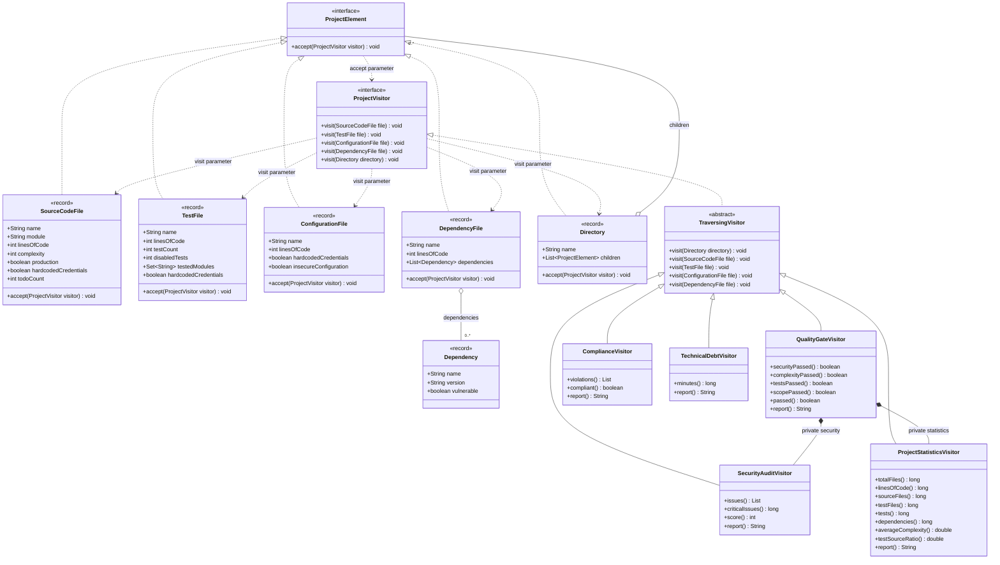
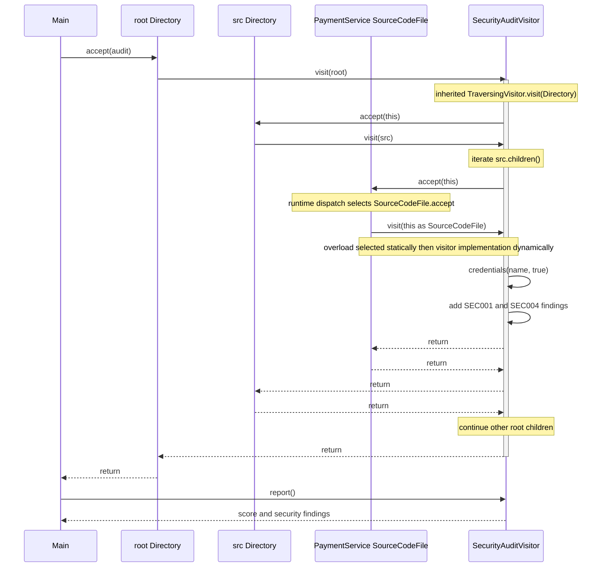

# UML diagrams

These Mermaid diagrams render directly on GitHub. Names and relationships refer to the Java implementation in `inspection`.

## Class diagram

`Directory` uses aggregation because immutable children can be shared. `QualityGateVisitor` owns its private delegates. Java record components are shown as public accessor-visible properties; their generated backing fields are private. All concrete visitors override the relevant leaf overloads and inherit directory traversal. `Checks` and report value records are omitted for readability because they do not participate in dispatch.

## Sequence diagram

The source node is reached through a `ProjectElement` child reference. Directory traversal is inherited by the same security visitor instance; there is no second traversal object.

